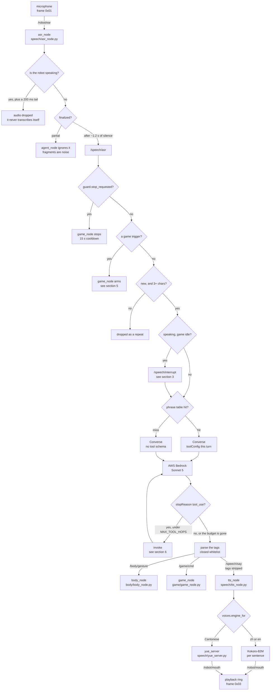
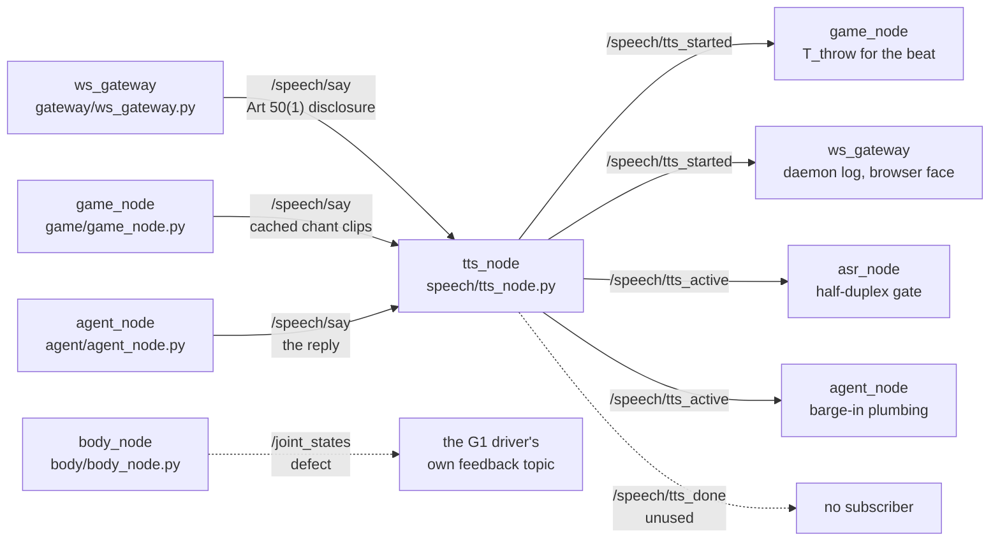
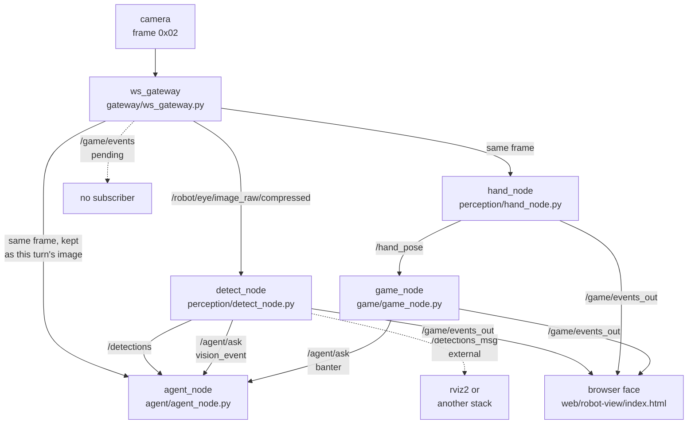
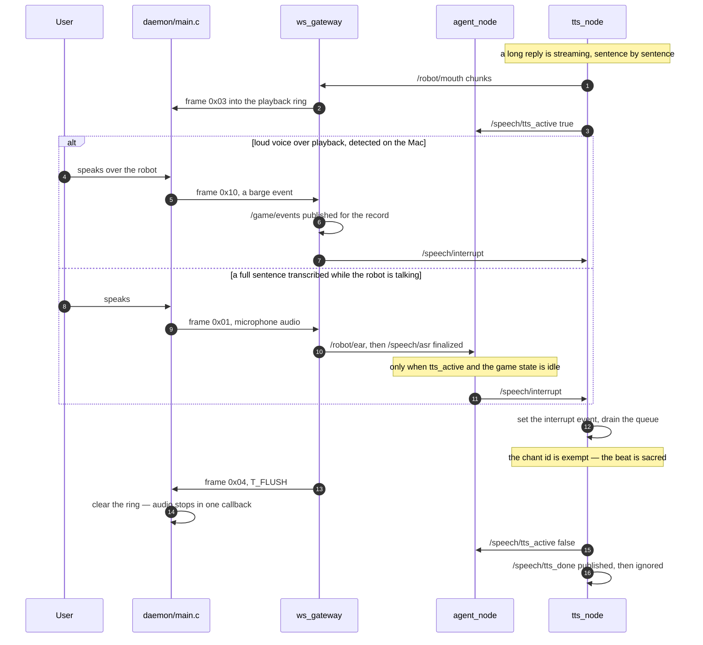
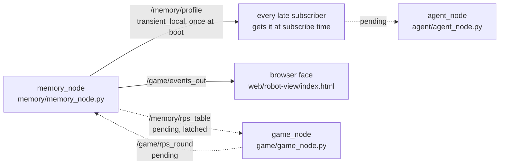
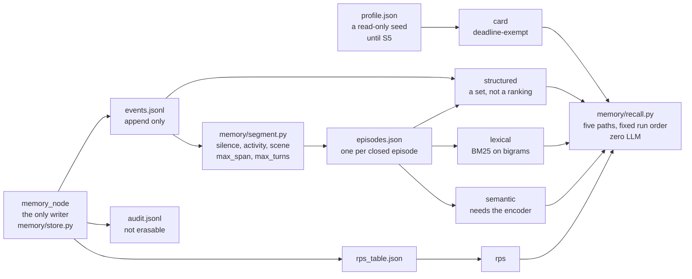
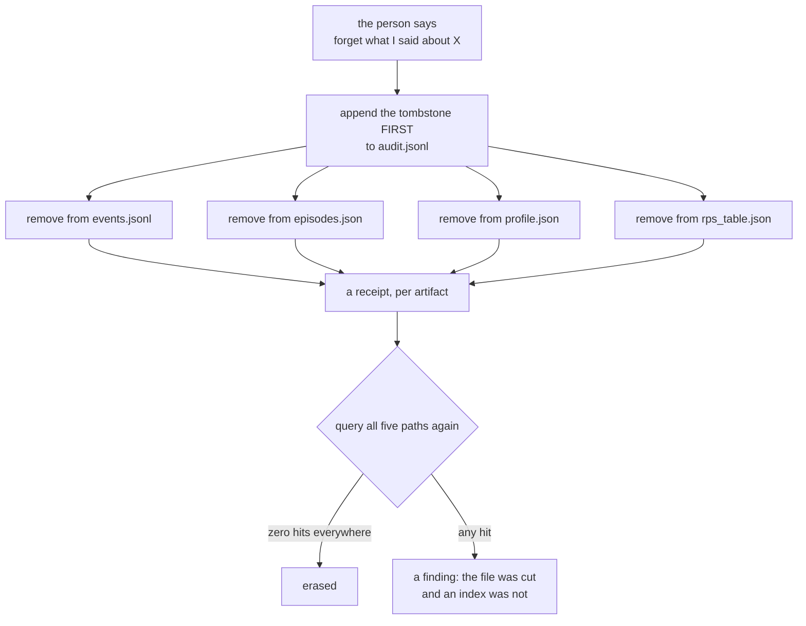
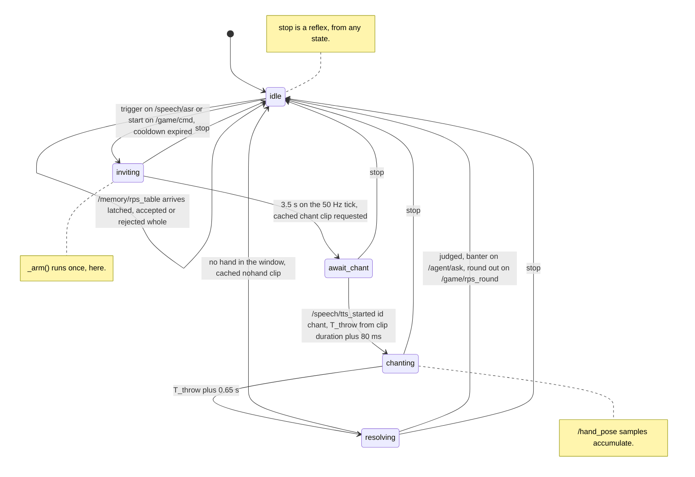
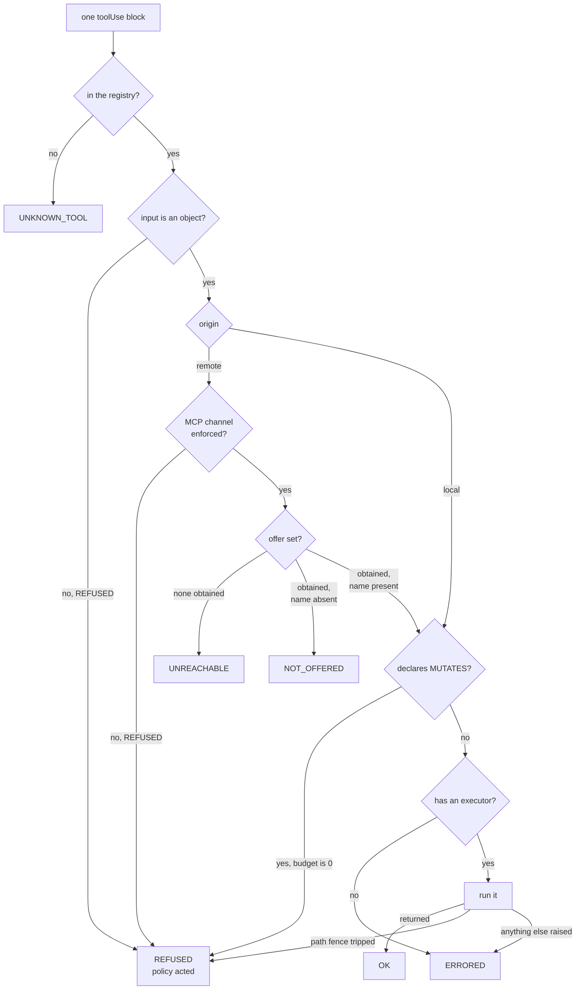
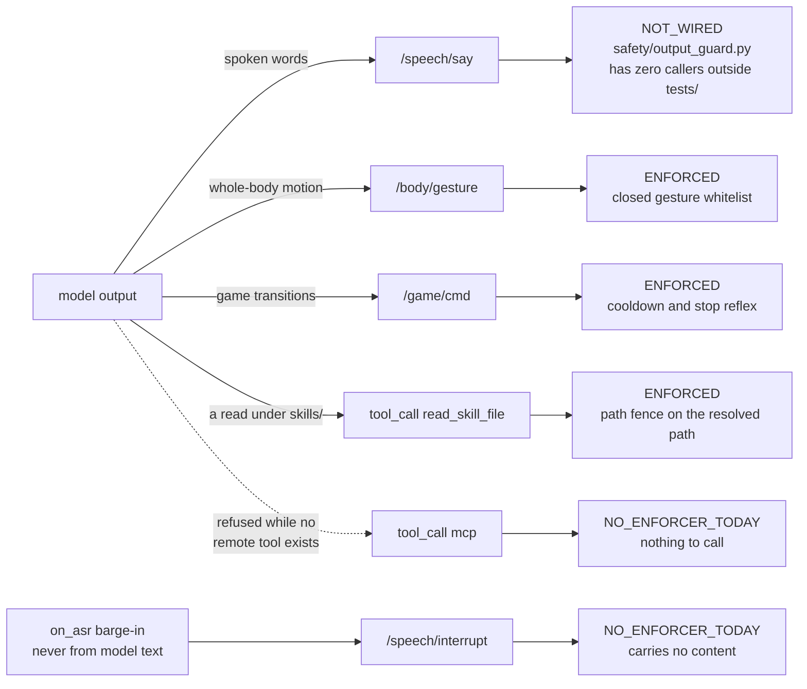

# Workflow charts — open-agent-robot

`docs/architecture.svg` draws the **standing shape** of this robot: which processes exist,
which topics connect them, and where the graph has a loose end. This file draws the
**sequences** — what happens, in order, when someone speaks; what happens when they
interrupt; what happens when they ask to be forgotten; and what happens when the model
asks for a tool.

Both files are checked against the same source of truth. `infra/ros_census.py` executes
`OAR_DRY=1 infra/run_ec2.sh start-all` for the node inventory and walks the AST of every
launched file for its publishers and subscribers; `tests/test_architecture.py` then asserts
in **both directions** that every node file and every topic the census finds is named in
these diagrams, and that every node file and topic these diagrams name exists in the
census. That is the whole reason this is Mermaid in a repo file rather than a picture: a
drawing nobody can execute drifts silently, and the way it drifts is by staying beautiful.

## Conventions

| Notation | Meaning |
|---|---|
| solid edge | both ends exist in the tree today and the census sees them |
| dashed edge | a topic with only one end wired — the label carries its class from `infra/graph_gaps.tsv` |
| `external` | the missing end is deliberately outside this repo |
| `pending` | the missing end belongs to a stage that has not landed |
| `defect` | the edge is wrong as drawn, and the fix is known and written down |
| `unused` | published as an observable signal with no consumer designed yet |

A dashed edge is not decoration. Each one has a reviewable row in `infra/graph_gaps.tsv`
stating why it is acceptable, and `tests/test_architecture.py` fails both when a censused
asymmetry has no row and when a row describes a topic that is no longer asymmetric — the
second direction is the one that matters, because a stale excuse silently covers the next
topic that arrives with the same name.

**Every label here is a caption, not an explanation.** The reasoning lives in the prose
under each chart. That is a layout decision with a measurement behind it: the first draft
of §1 put a sentence in every box and rendered 3141 px wide, which GitHub scales to its
content column and turns into unreadable grey. Diagram widths are checked in
`docs/evidence/mermaid-render.json`.

---

## 1. One turn, ear to mouth

Read this as a chain of decisions, not as a picture of processes — the process-and-topic
containment picture is `docs/architecture.svg`, and drawing it twice is how two drawings
start disagreeing. Topic names ride on the edges.

Four things in that chain are load-bearing and easy to miss.

**The stop reflex is checked before anything reads the state.** `safety.guard.stop_requested`
is a pure function of the utterance, so the reflex structurally cannot depend on which
state `game_node` happens to be in. A copy of the stop-word list inside the game node
would have produced a robot that stops in one state and not another.

**The skill gate is a phrase table, not a judgement.** `skills/loader.py` decides from a
frozen table whether a skill's body rides along on this turn. Asking the model whether it
needs a skill would put an LLM in the position of deciding what enters its own prompt, and
`docs/test-design.md` §0 rule 1 forbids an LLM judge anywhere a gate is.

**`toolConfig` is attached per turn, not resident.** A tool schema costs input tokens on
every turn it is present, so today it is present only on turns where a skill fired. That
is also why `agent/tools.py` carries a spec ceiling: a resident catalogue has to argue with
a number instead of appearing for free on every turn forever.

**The action tags are parsed after the fact against a closed whitelist.** This is
deliberately *not* constrained decoding or tool use — reason freely, constrain late. The
`\w+` capture cannot express a colon, which is what keeps model text from reaching the
chant's parameter form.

Three processes publish into that one mouth, and the mouth announces back what it is
doing — `agent_node` on the path above, and two others that never consult the model:

The disclosure has a deterministic publisher for a legal reason: EU AI Act Art 50(1) says
the person must be told they are talking to a machine, and a system prompt asking the model
to mention it is a system that complies when the model happens to remember.

`/speech/tts_started` carries the EU AI Act Art 50(2) synthetic marking, and both the
cached and the streaming path publish it through one function — so the marking cannot be
present on one path and missing on the other, and a third path added later inherits it
instead of having to remember it. `/joint_states` is the one **defect**-class edge in the
graph: publishing it collides with the real driver's feedback topic on hardware, and the
fix is to publish `/joint_commands` instead.

---

## 2. The seeing lane

Vision runs on its own clock and never blocks a turn. Two nodes read the same frame for
different reasons, and a third consumer — the model itself — gets the raw frame attached to
the current turn.

`detect_node` is time-gated to about 5 fps with the newest frame winning, and a
`vision_event` is throttled to one per 30 s and suppressed entirely while the robot is
speaking or a game is running — an unprompted remark is only charming when it is rare.
The frame reaches the model as well as the detector because YOLO's COCO-80 vocabulary
cannot see a pen or a hat and the VLM can.

The two one-ended edges here are the most instructive in the repo. `/detections_msg` is a
dead end **on purpose** — it is the standard ROS message shape, published for tools outside
this tree. `/game/events` is a dead end **by omission** — the browser can already send
events and nothing consumes them, so clicking the robot's face reaches the bus and stops
there, and voice is the only wired way in.

---

## 3. Stopping a voice already in the air

A guard verdict, or a person changing the subject, has to stop audio that has already been
synthesized, published, and queued on another machine. Every hop below is a callback that
does no work, which is what makes the deadline achievable.

Two subtleties this encodes.

**The interrupt has two publishers and two subscribers.** `agent_node` publishes it on
barge-in and `ws_gateway` publishes it when the daemon reports a loud voice; `tts_node`
subscribes to stop synthesizing and `ws_gateway` subscribes to flush the Mac's ring. The
gateway is on both sides of the same topic, and that is intentional — the flush has to
happen no matter who decided to interrupt.

**The chant exemption is computed in one place.** A reply of exactly the text `chant` once
fell through the request-id fallback and exempted itself from every interrupt this robot
has. `speech/voices.py` now owns the id namespace, so the exemption cannot be claimed by
model output.

---

## 4. The single writer

One process writes to disk. Everything else sends a message. That is not tidiness: the
append-only stream's atomicity assumption breaks the moment a second writer exists, and
the break is invisible until someone reads the file back.

On the bus, `memory_node` publishes one thing and is owed two:

On disk, one writer owns five artifacts, and five retrieval paths read them:

**`transient_local` and no republish timer.** `agent_node` needs the profile card on its
very first turn and starts in whatever order the runner's shell loop happens to start
things, so a volatile publisher would leave every later subscriber with nothing. There is
deliberately no periodic republish either: a timer would make a subscriber that forgot to
ask for `transient_local` durability *look* like it works — it would get the card on the
second tick — and then silently have no profile on the first turn, which is the turn that
matters. The failure has to be immediate or it gets discovered in production.

**The card path is exempt from the 150 ms recall deadline because it *is* the degraded
turn.** The exemption is checked per path rather than inferred from position in the run
order, so moving `card` last would not break it — an invariant needs a line that creates
it, not an ordering that implies it.

**Three of the edges above are dashed, and two of them are one gap counted twice.**
`game_node` hands each resolved round to the writer and subscribes latched for the
accumulated table; `memory_node` has no subscriptions at all yet, so no round is persisted
and the table starts empty every boot. `tests/test_architecture.py` asserts that pair stays
paired, because wiring one end alone would look like progress and change nothing.

---

## 5. What "forget what I said" costs

**Why the tombstone is written before the removals.** If the process dies between the two,
the audit log claims a removal the disk has not performed — and that state is *detectable*,
which is the point. The reverse order produces a disk that has forgotten something the
audit log never recorded, and nothing can find that afterwards.

**Why the eraser registry is derived from the disk rather than from the retrieval paths.**
Retrieval names what is *retrievable*; erasure has to cover what is *stored*, and the audit
log is stored and never retrieved. A registry derived from the recall paths would have
quietly left it out.

**Why the audit log is not erasable, and why a tombstone quotes nothing.** A tombstone is
the record that something was deleted, so it cannot live in the file it is a record about —
and its field set is closed with no room for a copy of the deleted content, because a
tombstone quoting what it deleted would preserve exactly what it was asked to remove.

The two retention paths share this machinery: `user_requested_forget` is the sentence said
out loud, `scheduled_retention` is the sweep that nothing caused. Both write a tombstone
with a goal, so "why did this disappear" has an answer.

---

## 6. game_node's states

The beat never touches the LLM, ASR, or the opponent model. The move is committed at arm
time — roughly 3.5 s before the chant starts — so nothing on the beat path can be slow.

Four things that chart cannot say on its own.

**`_arm()` consults the opponent model once, at arm time, and nowhere else** — that is what
keeps a statistical model off the beat path. If it raises, the fallback is a plain uniform
draw and deliberately **not** the model's own `uniform_move()`: asking a broken object for
the safe answer asks a broken object.

**The hand vote reads the window around `T_throw` and breaks ties on a fixed order.** A
hash-seeded tie-break read the same window as paper under one seed and rock under another,
which is a coin flip wearing the clothes of a measurement.

**`stop_game()` is idempotent, and stop is decided by a pure function that cannot see this
node's state.** Streaming ASR repeats the same utterance two to four times, so a
non-idempotent stop would fire the cooldown three times over.

**The cooldown is enforced on both entry paths** — 3 s after a resolved round, 15 s after a
stop. It used to be checked only on the voice trigger, and the model chained games back to
back through `/game/cmd` until it was checked there too.

---

## 7. The tool boundary: six outcomes, one of which means the boundary acted

`agent/tools.py` exists before any MCP client does, because a boundary is free to draw
exactly once — before the first thing that would have to be migrated across it. The chart
below is the whole of `invoke()`.

Each outcome is a different sentence, and that is the design:

| Outcome | What it is a claim about |
|---|---|
| `OK` | the tool ran and returned |
| `REFUSED` | **policy** — the only outcome that licenses "the boundary held" |
| `UNKNOWN_TOOL` | the name is not in this registry at all |
| `NOT_OFFERED` | server drift: declared here, absent from the live offer set |
| `UNREACHABLE` | the network — we never asked |
| `ERRORED` | the executor raised and we do not know what happened |

`BOUNDARY_ACTED` is written as a tuple over the outcome set and not as `outcome != OK`,
because `!= OK` is how an outage becomes a safety claim. A report that counts
`UNREACHABLE` as a refusal says the robot was protected by a network failure.

Two more properties of that chart that are not visible in it. An offer set of `None` is
**not** an empty one — an empty set says the server has no tools, no set at all says we do
not know, and folding them together is the `[]`-with-four-causes failure again. And
`MAX_EFFECT_HOPS` is `0`, a separate number from `MAX_TOOL_HOPS`, because three file reads
and three irreversible actions are the same integer describing two very different
exposures: a tool declaring `MUTATES` cannot be invoked at all today, and raising that
number is an edit to that file, in a PR, next to the paragraph explaining it.

The reconciliation rule points one way only. A tool the server offers and the repo does not
declare is a **finding**, never a tool: discovery may narrow the registry and may never
widen it. Otherwise the tool surface stops being a property of this repo the day an MCP
client lands, and the offline suite structurally cannot assert the boundary any more.

---

## 8. What the model's output can reach

The other half of the same question — not *what can the model invoke* but *what can the
model's output reach*, with the enforcer that actually runs on it.

`NOT_WIRED` and `NO_ENFORCER_TODAY` are kept apart on purpose. Both mean nothing runs on
the channel; one is a missing call and the other is a missing component, and a table that
folded them together would have described S7 as protection. Wiring the guard is S7's
runtime half, which needs the instance.

The honest reading of this chart today: **the channel that carries the robot's voice is the
unguarded one.**

---

## What these charts deliberately do not show

- **No timings that were not measured.** Where a number appears — the 3.5 s invite, the
  0.65 s resolve delay, the 80 ms playback lag, the 150 ms recall deadline, the cooldowns —
  it is a constant read out of the source, not a latency claim. Measured latencies live in
  `docs/evidence/` with their sample counts, because a number typed into prose is an
  unverified number.
- **No QoS depths.** They are in the source and they change; a diagram repeating them would
  be a second copy nothing forces to agree with the first.
- **Nothing about the on-instance half of S5, S7 and S8.** Those need the security group
  opened to a single address, which has not happened, and a diagram cannot make an
  unmeasured path work.
